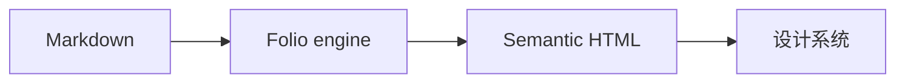

Folio 的正文使用 Markdown 编写。React 阅读页与静态输出共用同一个 `renderFolioMarkdown()` 渲染器，因此开发预览、线上页面与静态 HTML 的排版结果一致。

::: warning 只渲染可信仓库内容
Folio 0.1.x 会原样保留 Markdown 里的原始 HTML、`::: html` 块与 Callout 正文，不做 HTML 清理，也不过滤 `javascript:` 链接。只应渲染经过审核并已合并的仓库内容；未经审核的投稿、抓取页面或外部 PR 预览不能直接交给当前渲染器。
:::

## 标题与锚点

页面标题由布局渲染，正文从 h2 开始：

```md
## 导航与阅读

### 侧栏

## 页面布局
```

- h2–h4 会进入页内目录，并生成稳定、去重的锚点。
- 标题里的链接、行内代码与 HTML 实体会参与锚点计算。
- 显式保留 `id` 的 HTML 标题不会被重新编号。
- 更深的 h5、h6 不进入目录，但仍按 Markdown 正常渲染。

## GFM 表格

```md
| 能力 | 状态 |
| --- | --- |
| GFM 表格 | 内置 |
| 任务列表 | 内置 |
| 删除线 | 内置 |
```

| 能力 | 状态 |
| --- | --- |
| GFM 表格 | 内置 |
| 任务列表 | 内置 |
| 删除线 | 内置 |

## 代码块与高亮

写代码块时标注语言，Folio 会用 highlight.js 做语法高亮：

~~~ts
export function hello(name: string) {
  return `Hello, ${name}`;
}
~~~

未标注或无法识别的语言会回退到自动检测；带 `mermaid` 标记的代码块交给 Mermaid 渲染，而不是普通代码高亮。

## Callout

支持五种提示块：

| 类型 | 默认标题 |
| --- | --- |
| `tip` | 提示 |
| `info` | 信息 |
| `note` | 说明 |
| `warning` | 注意 |
| `danger` | 警告 |

```md
::: tip
先写结论，再补细节。
:::
```

::: tip
先写结论，再补细节。
:::

Callout 正文本身支持 Markdown；它适合补充说明与风险提示，不应替代正文结构。

## Mermaid

~~~md

~~~

Mermaid 是渐进增强：HTML 中始终先保留可读源码，浏览器加载 Mermaid 成功后再替换为 SVG。渲染失败时不会吞掉内容。

## 原始 HTML

需要嵌入图表、视频或站点组件时，可以直接写 HTML，或使用 `::: html` 块：

```md
::: html
<figure class="site-figure">
  
  <figcaption>由站点样式负责排版。</figcaption>
</figure>
:::
```

原始 HTML 原样输出，适合可信仓库内容，不适合用户投稿。

## 渲染入口与选项

React 阅读页：

```tsx
import { FolioMarkdown } from "@uichat-mira/folio";

<FolioMarkdown source={doc.body} options={{ removeH1: true }} />;
```

静态构建或自定义输出：

```ts
import { renderFolioMarkdown } from "@uichat-mira/folio";

const html = renderFolioMarkdown(doc.body, {
  removeH1: true,
  headingAnchors: true,
});
```

- `removeH1` 去掉正文里重复的一级标题；Folio 的阅读布局默认开启。
- `headingAnchors` 为 h2–h4 生成锚点与目录链接，默认开启。

## 失败语义

Mermaid 渲染失败时保留源码，不会留下空白区域；内容错误应在上线前通过构建与人工检查发现。

## 相关文档

- [编写内容](/guide/authoring)
- [内容类型与路由](/guide/content-types)
- [Frontmatter 与元数据](/guide/frontmatter-fields)
- [消费者契约](https://github.com/uichat-mira/folio/blob/dev/docs/consumer-contract.md)
