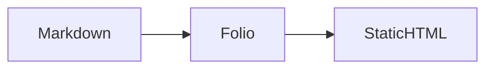

# Folio consumer contract (0.1.x)

This file is the single source of truth for what `@uichat-mira/folio` 0.1.x (including the published 0.1.1 patch) promises an npm consumer: which Markdown input the renderer can handle safely, how the default stylesheet behaves when it is imported, and which static-site capabilities belong to the library versus the site.

The root `README.md`, `packages/folio/README.md`, and the Markdown/static documentation link here and keep only short summaries. When the behavior changes, update this file first.

## At a glance

- **Markdown is trusted-content-only.** Raw HTML, `::: html` blocks, and Callout bodies are preserved without sanitization. Do not feed unreviewed submissions, scraped pages, or external PR previews into the renderer.
- **`styles.css` is a whole-site stylesheet.** It assumes Folio owns the document. It is not an isolated embed stylesheet, and importing it into an existing branded page changes that page globally.
- **The default static document shell works without JavaScript.** Sidebar, in-page TOC, and previous/next survive with JS disabled. Sites that supply custom static route bodies own that markup and do not get the shell.
- **`@uichat-mira/folio@0.1.1` is publicly published through GitHub Release and npm OIDC.** The release workflow's second attempt passed independent Registry-installed consumer checks; the initial 0.1.0 bootstrap was manual.
- **The published package includes virtual-module types.** Strict Registry-installed consumers resolve `default` and `roots` without writing a local `declare module`.

## Package status and installation

Folio `0.1.0` was manually bootstrapped from accepted `prod` SHA `40db582b20b5be7a070ab936a99255a75ca15232` on 2026-11-01, then independently verified via [FOL-016 Registry consumer evidence](https://github.com/uichat-mira/folio/actions/runs/41247604056). Folio `0.1.1` was subsequently published through [GitHub Release `folio-v0.1.1`](https://github.com/uichat-mira/folio/releases/tag/folio-v0.1.1) and the [OIDC workflow](https://github.com/uichat-mira/folio/actions/runs/41282326983): initial publish succeeded with signed provenance, but its public Registry probe timed out during npm processing; the same workflow's successful second attempt verified the immutable Registry version, its SRI, and the external consumer. Runtime and public API behavior did not change in this patch.

Install the published version with:

```bash
npm install @uichat-mira/folio
```

For source changes, the repository's `release:check` still verifies a locally packed tarball:

```bash
npm ci --no-audit --no-fund
npm run release:check
```

`release:check` type-checks and tests the package, builds the official site, audits the packed file list, then installs the produced tarball into a throwaway Vite + React consumer and builds that consumer.

The package is ESM (`"type": "module"` with `import`/`default` export conditions). The source candidate now packages a referenced `virtual:folio/content` ambient declaration alongside its public JavaScript entrypoint types.

| Entry point | Contents |
| --- | --- |
| `@uichat-mira/folio` | Content parsing, configuration helpers, React runtime (`FolioApp`, `FolioHeader`, `FolioDocsShell`, `FolioMarkdown`), Markdown rendering, search and doc-structure helpers |
| `@uichat-mira/folio/vite` | The `folio()` Vite plugin, `virtual:folio/content`, and the static publishing helpers and types |
| `@uichat-mira/folio/styles.css` | The default design tokens and stylesheet (CSS only) |

Peer requirements: React `^19`, React DOM `^19`, React Router DOM `^7`, and Vite `^7`. Folio's own `engines.node` declares `>=20`, but the Vite 7 peer requires Node.js `20.19+` or `22.12+`; use Node 24 for the tested build and release workflow.

## Independent consumer verification and virtual module types

[FOL-014](research/fol-014-default-ui-acceptance.md) independently installed the actual `.tgz` outside the workspace and exercised the unbranded Folio default UI in Chrome 156 at desktop 1440×900 and mobile 375×812, in both light and dark modes. The captured screenshots, DOM and console results support a **usable default reading experience** with sidebar, TOC, pager, mobile drawer and theme switching; the report documents the tested surfaces and exclusions. These tests use browser-side DOM `element.click()` to verify event wiring, **not** physical touch hit-testing. The original mobile menu/navigation/close button bounds measured approximately 21 px; the later minimum 40px touch-target CSS adjustment is not part of those historical screenshots. Safari, real devices and a final candidate retest remain unverified.

**Original FOL-014 regression evidence:** its real tarball generated `TS2307` when a consumer imported `virtual:folio/content` without a project-local declaration. The historical report and saved results remain unchanged. The current **source candidate** includes a `dist/virtual.d.ts` ambient declaration, reachable from `dist/index.d.ts` and `dist/vite.d.ts`. The tarball consumer gate now checks strict NodeNext and Bundler TypeScript imports of both `default` (`FolioDoc[]`) and `roots` (`string[]`) **without a consumer shim or `skipLibCheck` bypass**.

**TypeScript-only virtual imports:** TypeScript only loads ambient declarations from referenced packages. A typical app already imports `@uichat-mira/folio` in the same TypeScript project and needs no additional setup. If a separate TS project *only* imports `virtual:folio/content` (for example, a UI program that excludes its Vite config and never imports either Folio package entry), register the installed package's published types via `compilerOptions.types`, alongside that project's other required types:

```json
{
  "compilerOptions": {
    "types": ["vite/client", "@uichat-mira/folio"]
  }
}
```

This is **type entry registration**, not a local `declare module` workaround. It is necessary in virtual-only TypeScript programs because an otherwise unreferenced dependency cannot inject its ambient declarations automatically. Both ordinary imports and this explicit-registration case are covered by the tarball consumer checks.

The real npm Registry 0.1.0 package passed strict TS/Vite/static-site tests. The final pre-production Chrome browser acceptance passed 23/23 checks and measured 40px React touch targets; this does not prove physical-device touch behavior.

## Markdown: trusted repository content only

Folio renders Markdown for content that the site owner controls and has reviewed before merge. That is a product decision for 0.1.0, not a temporary gap: the renderer has no HTML sanitizer and no dangerous-URL filter.

The same renderer output reaches the page in all three consumption paths:

- `renderFolioMarkdown()` returns the HTML string;
- `FolioMarkdown` inserts that string with `dangerouslySetInnerHTML`;
- static generation places it in the generated route body.

### What works

- GFM tables, task lists, strikethrough, and fenced code blocks with `highlight.js` highlighting.
- Callouts written as `::: tip`, `::: info`, `::: note`, `::: warning`, or `::: danger`. Mermaid fenced blocks render as diagrams in the browser, with a readable source fallback when rendering fails.
- Raw HTML and inline HTML in Markdown, `::: html` blocks, and inline SVG. Classes, `id`, and inline `style` are preserved, so existing design-system pages built from `<div>`, `<section>`, and `<svg>` keep their layout. This is a kept feature, not a deprecation: 0.1.0 does not strip or disable HTML.
- Heading anchors: level-two through level-four headings (`h2`–`h4`) receive stable, de-duplicated `id` attributes and a `#` anchor link. A heading with an explicit `id` keeps it (and reserves it from auto-allocation) but does not receive the `#` anchor link. Passing `headingAnchors: false` skips the step, so auto-generated ids and anchor links are not added; explicit ids stay as written.

### What it does not do

The renderer does not remove HTML event attributes (`onerror`, `onclick`), `javascript:` URLs, `iframe`/`srcdoc`, or unsafe SVG/MathML content. It does not parse and rewrite raw HTML; blocks pass through as written. That is why the output is only appropriate for trusted Markdown.

- Callout bodies are parsed as Markdown and are **not** a sanitization boundary.
- Fenced code is escaped, but escaping code does not make raw HTML elsewhere in the document safe.
- `removeH1` and `headingAnchors` are formatting options, not security switches.
- Mermaid runs with `securityLevel: "strict"`, which protects Mermaid's own rendering boundary only.

### What "trusted" means

Trusted content is content that was reviewed and merged by maintainers who may already publish HTML on the site. Repository provenance alone is not enough: an unreviewed external pull request, a Markdown file pulled from a remote source, a user submission, or multi-tenant content is not trusted just because it lives in Git.

If you need to display untrusted input, 0.1.0 does not provide a safe path. Do not pass it to these APIs. Sanitizing at a separate, maintained boundary before rendering is a consumer-side design decision; do not assume that `removeH1`, React's JSX escaping, Mermaid strict mode, a CSP, or a WAF makes the default renderer safe for untrusted Markdown.

### Trusted Markdown example

The following content is safe to use because the site owner authored or reviewed it:

````md
---
title: Release notes
type: doc
group: Docs
order: 1
---

## What changed

- Faster content discovery
- Clearer static output

::: tip
Run `npm run release:check` before publishing a new version.
:::

::: warning
Raw HTML below is trusted repository content, not user input.
:::

::: html
<div class="callout-grid" style="display:grid;gap:12px">
  <span>Custom layout preserved for trusted authors</span>
</div>
:::


````

### Do not pass untrusted input

These constructs are intentionally preserved, so they are exactly why unreviewed content must not reach the renderer:

```md


[click me](javascript:doSomething())

::: warning
Callout bodies pass through too.

:::
```

## Styles: whole-site default stylesheet

`@uichat-mira/folio/styles.css` is the default stylesheet for a site that Folio owns. Import it once at the application entry, next to the runtime:

```ts
import "@uichat-mira/folio/styles.css";
import { FolioApp } from "@uichat-mira/folio";
```

This is the supported 0.1.0 mode and the mode the official site uses. The stylesheet defines the `--folio-*` design tokens and component rules scoped under `.folio-*`, `.folio-markdown*`, `.markdown-mermaid*`, and `[data-folio-theme]`. Five rules are not scoped and act on the whole document:

| Rule | Effect |
| --- | --- |
| `:root` | Defines the `--folio-*` tokens; sets `font-family`, `color`, and `background` on `<html>`; sets `font-synthesis: none` and `text-rendering: optimizeLegibility`, which are inherited |
| `*` | `box-sizing: border-box` on every element |
| `body` | `margin: 0`, `min-width: 320px`, canvas background, ink text color |
| `a` | `color: inherit`, `text-decoration: none` |
| `button, input` | `font: inherit` |

### Importing into an existing branded page

`FolioMarkdown` renders an article inside whatever document the host already has. The stylesheet does not scope itself to that article, so importing it turns the host page into Folio's baseline. The measured effects are:

- **Independent of load order**, unless the host declares a competing property: `* { box-sizing: border-box }` can change the size of fixed-width host boxes; `body { min-width: 320px }` applies to the host body; and the inherited `font-synthesis: none` / `text-rendering: optimizeLegibility` reach host text, which can remove browser-synthesized bold/italic faces and change kerning and ligatures.
- **Dependent on load order**: the host's own `body` margin/background/text color, link color/underline, and `button`/`input` font and font size are overridden when the Folio stylesheet loads after the host stylesheet. Loading the host stylesheet after Folio's wins those declarations at equal specificity.
- **Folio content does not inherit host variables.** `.folio-markdown` text uses `--folio-body`, headings use `--folio-font-display`, and the article keeps the Folio palette. Branding means overriding `--folio-*` tokens, not reusing host custom properties.

0.1.0 does not ship an isolated `embed.css` or a scoped stylesheet entry. Treat the default stylesheet as a whole-site entry, not as an embeddable, isolated style scope.

### Guidance for embedding

1. Prefer the whole-site mode unless the host page genuinely owns the document.
2. If the host must keep its own baseline, load the host stylesheet after the Folio stylesheet so equal-specificity element rules resolve to the host.
3. Declare competing properties for the effects that do not depend on order:

```css
:root {
  font-synthesis: auto;
  text-rendering: auto;
}

body {
  min-width: 0;
}

/* Only when the host baseline is content-box. */
* {
  box-sizing: content-box;
}
```

These declarations are visual overrides, not a security or isolation mechanism. Re-check a real host page after importing Folio, because the affected rules apply to elements the host already styled.

## Static output: default shell vs custom routes

The Vite plugin writes directory-style HTML for every route (`<route>/index.html`) plus `404.html`, and, when `siteUrl` is configured, `sitemap.xml` and `robots.txt`. All routes share the same metadata pipeline: title, description, robots, canonical, Open Graph, Twitter Card, and JSON-LD.

### Default document shell (`staticRoutes: true`)

```ts
import { folio } from "@uichat-mira/folio/vite";

export default {
  plugins: [
    folio({
      contentDir: "content",
      config: { title: "My docs", description: "Documentation" },
      staticRoutes: true,
    }),
  ],
};
```

For `type: doc` entries the generated page includes the static document shell: a sidebar with every document in the collection, an in-page table of contents, and previous/next links. Every link points at a real generated file, so navigation, section jumps, and previous/next work with JavaScript disabled. Other entry types render a simpler main region with their article body and no docs sidebar or pager.

The default home route is only a minimal title/description prerender with no links into the docs. Supplying custom routes replaces every route, so a site that needs a different home route also takes ownership of the document bodies and their no-JS navigation.

### Custom route bodies (`staticRoutes: { routes }`)

```ts
import { defineConfig } from "vite";
import {
  folio,
  folioEscapeHtml,
  type FolioStaticBuildOptions,
} from "@uichat-mira/folio/vite";
import { renderFolioMarkdown } from "@uichat-mira/folio";

const config = { title: "My docs", description: "Documentation" };

const staticBuild: FolioStaticBuildOptions = {
  routes: ({ docs }) =>
    docs.map((doc) => ({
      path: doc.path,
      title: doc.title,
      description: doc.description,
      body:
        "<main><h1>" +
        folioEscapeHtml(doc.title) +
        "</h1>" +
        renderFolioMarkdown(doc.body, { removeH1: true }) +
        "</main>",
      doc,
    })),
};

export default defineConfig({
  plugins: [
    folio({ contentDir: "content", config, staticRoutes: staticBuild }),
  ],
});
```

A custom `routes` function replaces the generated route list and every route body. Folio still writes the files and metadata, but the default document shell is not applied to a body the site provides. The site owns the sidebar, TOC, pager, and therefore the no-JS behavior.

The official `apps/site` uses this mode: its static document pages contain the article body only. With JavaScript disabled a reader can read a page but cannot switch documents through a sidebar, use an in-page TOC, or follow previous/next links. The official site is therefore not fully navigable without JavaScript; that capability belongs to the default shell.

### Trailing slashes

Static links are directory URLs with a trailing slash (`/docs/guide/intro/`) because they point at generated `index.html` files. React Router links omit the trailing slash (`/docs/guide/intro`). GitHub Pages answers the no-slash request with a `301` to the slash form, so both link shapes resolve. This is a representation difference between directory indexes and SPA routes, not a defect.

### Heading anchors and TOC

`extractHeadings`/`doc.headings` and `renderFolioMarkdown` both build `h2`–`h4` anchors, including raw HTML headings. FOL-013 aligns TOC IDs with the rendered HTML for Markdown links (for example `## [Text](https://example.com)`), bare `&`, HTML entities, emphasis, and inline code. Duplicate headings and explicit `id` reservations remain supported. Punctuation-only headings receive addressable fallback IDs (`section`, `section-2`, etc.). Existing generated body IDs such as `faq-amp-支持` remain unchanged; the TOC now points to them, avoiding unnecessary breakage of existing anchor links. See FOL-013's cross-layer regression and the historical FOL-008 investigation for the original mismatch. Repeat FOL-014 browser navigation checks against the final release candidate after other pre-release fixes.

## Known limitations

- Unreviewed Markdown, scraped content, and user submissions are not supported in 0.1.0; the default renderer has no sanitizer.
- `styles.css` is not an isolated embed stylesheet, and no scoped `embed.css` entry exists in 0.1.0.
- Custom static route bodies replace the no-JS document shell; the site must provide its own navigation if it needs it.

## Where this is verified

The three boundaries above come from merged research, not from documentation inference:

- [FOL-003 · Markdown raw HTML trust boundary](research/fol-003-markdown-html-trust.md) — code-path and static-output probe for raw HTML, `::: html`, Callouts, and dangerous URLs.
- [FOL-007 · default stylesheet host impact](research/fol-007-css-host-impact.md) — browser measurements of the global rules in whole-site and embedded modes.
- [FOL-008 · static and React navigation parity](research/fol-008-navigation-parity.md) — real-build comparison of the default static shell, custom route bodies, TOC anchors, and no-JS navigation.

The research files are evidence for these behavior claims. They are not a browser security test and do not prove that a given site is safe.
