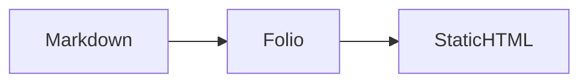

# Folio consumer contract (0.1.x)

This file is the single source of truth for what `@uichat-mira/folio` 0.1.x (including the published 0.1.1 patch) promises an npm consumer: which Markdown input the renderer can handle safely, how the default stylesheet behaves when it is imported, and which static-site capabilities belong to the library versus the site.

The root `README.md`, `packages/folio/README.md`, and the Markdown/static documentation link here and keep only short summaries. When the behavior changes, update this file first.

## At a glance

- **Markdown is trusted-content-only.** Raw HTML, `::: html` blocks, and Callout bodies are preserved without sanitization. Do not feed unreviewed submissions, scraped pages, or external PR previews into the renderer.
- **`styles.css` is a whole-site stylesheet.** It assumes Folio owns the document. It is not an isolated embed stylesheet, and importing it into an existing branded page changes that page globally.
- **The default static document shell works without JavaScript.** Sidebar, in-page TOC, and previous/next survive with JS disabled. Sites that supply custom static route bodies own that markup and do not get the shell.
- **`@uichat-mira/folio@0.1.1` is publicly published through GitHub Release and npm OIDC.** The release workflow's second attempt passed independent Registry-installed consumer checks; the initial 0.1.0 bootstrap was manual.
- **The published package includes virtual-module types.** Strict Registry-installed consumers resolve `default` and `roots` without writing a local `declare module`.
- **Article archives are opt-in per collection.** Without `collections[].archive`, a site gets no archive routes, entry points or tag links. With it, Folio derives `<collection>/category/<slug>` and `<collection>/tag/<slug>` from the FOL-040 Core index for both React and static output.

## Article category and tag archives (FOL-040 / FOL-041)

Category and tag archives are an opt-in reading surface for Article content. A
category is one archive dimension, not a column, tree, navigation level or
route directory; tags are zero or more topic labels. Neither changes an
Article's `path`, collection, group, section, search behavior or existing
permalink.

### Content

```md
---
title: 为什么内容要留在 Git
type: article
category: 工程实践          # optional; one non-empty string
tags:                       # optional; zero or more strings
  - Git
  - Content
---
```

- Only `type: article` documents enter archives. Documents, pages and other
  types keep their existing behavior.
- Frontmatter identity is normalized by Core: NFC, trim, collapsed whitespace
  and lowercase. `Frontend` and `frontend` therefore share one archive; Chinese
  labels are preserved. `category: ""`, non-string values and a missing value
  mean uncategorized.
- Category display labels can be overridden without changing URLs:
  `archive: { categoryLabels: { frontend: "前端" } }`.

### Configuration

```ts
import { defineFolioConfig } from "@uichat-mira/folio";

export default defineFolioConfig({
  // ...
  collections: [
    {
      path: "/blogs",
      title: "博客",
      // Opt in. `true` uses source labels; the object form adds display labels.
      archive: true,
    },
  ],
});
```

Route derivation uses the configured collection path, not `/blogs`:

| Surface | URL |
| --- | --- |
| Collection index | `<collection>` |
| Category archive | `<collection>/category/<slug>` |
| Tag archive | `<collection>/tag/<slug>` |
| Article | unchanged `doc.path` |

`<slug>` is the Core `group.slug` (`slugify` of the normalized label): Chinese
is preserved, ASCII is lowercased, punctuation is stripped. It is exactly one
URL path segment. Non-ASCII slugs are percent-encoded in the request URL (for
example `/blogs/tag/%E8%AE%BE%E8%AE%A1/` for `设计`), so a consumer that builds
its own archive URL must `encodeURIComponent` the slug segment.

### Default React UI

`FolioApp` reads `collections[].archive` automatically:

- the opted-in collection index gains one compact category row (only when
  categories exist) led by `全部`; a plain click filters that collection's entry
  list in place and does **not** change the route or add a history entry, so the
  category switch stays on one reading layer;
- the category row sticks directly below the site header
  (`top: var(--folio-header-height)`) while the collection list scrolls; it
  reuses the header's frosted canvas surface and fades into the list instead of
  drawing a full-width rule, so entries soften as they pass underneath;
- switching category resets the scroll position to the beginning of the
  filtered list when the reader has already scrolled past it (the list starts
  just below the sticky row); a shorter result set therefore never leaves the
  reader at the footer, and clicking a chip while already above the list does
  not jump down;
- the category chips keep their real archive URLs, so modified clicks, middle
  clicks, crawlers and no-JS pages still reach `<collection>/category/<slug>`;
- Article cards in that collection and the Article metadata area expose their
  tags as links;
- `<collection>/category/<slug>` and `<collection>/tag/<slug>` render the
  archive entry list, with a link back to the collection;
- an unknown archive slug renders the normal not-found page;
- the category row and tag links are **not** injected into the global header
  navigation.

### Static output

The default static route set (`writeFolioStaticSite` without a custom `routes`
function) emits the same archive pages as HTML:

- title, description and canonical come from the archive route and inherit
  `base` and `config.siteUrl`;
- archive URLs are included in `sitemap.xml`;
- `siteIndexing: "noindex"` applies to archive pages exactly as to other
  default pages, so a preview build does not publish indexable archive pages;
- the generated HTML is readable without JavaScript and uses the same entry
  list, ordering and links as React; its category row starts with the active
  `全部` chip and each chip is a normal link to the archive page. Loading the
  React runtime upgrades that row to the in-place filter described above.

Consumers that supply their own static `routes` own that page markup, as with
every other custom static route. They can still consume the same Core index
instead of reimplementing archives:

```ts
import {
  buildFolioArticleArchiveIndex,
  findFolioArticleArchiveGroup,
} from "@uichat-mira/folio";
```

The official site (`apps/site`) is such a consumer: it builds its archive
routes from each configured collection path and renders the same entry list and
tag links as the default UI.

### Conflict safety

Archive routes participate in the normal static route safety layer. A build
fails before writing anything when an archive URL collides with a document,
a configured collection index, another archive route or a custom static route.
React route derivation fails with `folio article archive route conflict` so a
document route cannot be silently shadowed. Two distinct labels that collapse
to the same URL slug (`C++` / `C#`) fail in Core rather than sharing one
archive.

### Non-goals

No column/tree hierarchy, sub-categories, multi-select filters, tag clouds,
pagination, comments, CMS, database, automatic header navigation or Article
permalink change is part of this contract.


## Package status and installation

Folio `0.1.0` was manually bootstrapped from accepted `prod` SHA `40db582b20b5be7a070ab936a99255a75ca15232` on 2026-11-01, then independently verified via [FOL-016 Registry consumer evidence](https://github.com/uichat-mira/folio/actions/runs/41247604056). Folio `0.1.1` was subsequently published through [GitHub Release `folio-v0.1.1`](https://github.com/uichat-mira/folio/releases/tag/folio-v0.1.1) and the [OIDC workflow](https://github.com/uichat-mira/folio/actions/runs/41282326983): initial publish succeeded with signed provenance, but its public Registry probe timed out during npm processing; the same workflow's successful second attempt verified the immutable Registry version, its SRI, and the external consumer. Runtime and public API behavior did not change in this patch.

Install the published version with:

```bash
npm install @uichat-mira/folio
```

For source changes, the repository's `release:check` still verifies a locally packed tarball:

```bash
npm ci --no-audit --no-fund
npm run release:check
```

`release:check` type-checks and tests the package, builds the official site, audits the packed file list, then installs the produced tarball into a throwaway Vite + React consumer and builds that consumer.

The package is ESM (`"type": "module"` with `import`/`default` export conditions). The source candidate now packages a referenced `virtual:folio/content` ambient declaration alongside its public JavaScript entrypoint types.

| Entry point | Contents |
| --- | --- |
| `@uichat-mira/folio` | Content parsing, configuration helpers, React runtime (`FolioApp`, `FolioHeader`, `FolioDocsShell`, `FolioMarkdown`), Markdown rendering, search and doc-structure helpers |
| `@uichat-mira/folio/vite` | The `folio()` Vite plugin, `virtual:folio/content`, and the static publishing helpers and types |
| `@uichat-mira/folio/pwa` | Optional `folioPwa()` Vite integration and the deterministic content-version helper. Emits a manifest, a Workbox service worker and `folio-version.json`; nothing is emitted unless a consumer calls it |
| `@uichat-mira/folio/pwa/react` | Optional `FolioPwaUpdatePrompt` and `useFolioPwaUpdate()`. Wraps the upstream `virtual:pwa-register/react` client, adds a throttled start/foreground update check and a prompt that never reloads without confirmation |
| `@uichat-mira/folio/styles.css` | The default design tokens and stylesheet (CSS only) |

Peer requirements: React `^19`, React DOM `^19`, React Router DOM `^7`, and Vite `^7`. Folio's own `engines.node` declares `>=20`, but the Vite 7 peer requires Node.js `20.19+` or `22.12+`; use Node 24 for the tested build and release workflow.

## Optional PWA contract (FOL-039)

The PWA entries above are additive and explicit. This section is the 0.1.x
promise for them; it does not change the plain `folio()` contract.

- **Opt-in only.** `folio()` never emits a manifest, a Service Worker or a
  registration script. A consumer that does not call `folioPwa()` gets exactly
  the previous behavior and does not install Workbox.
- **Optional peers.** `vite-plugin-pwa` (`^2`) and `workbox-window` (`^7.4.1`)
  are declared with `peerDependenciesMeta.optional`, so `npm install
  @uichat-mira/folio` stays dependency-free for sites that do not opt in. A
  consumer that opts in installs both.
- **Upstream engine.** The integration uses `vite-plugin-pwa` with the
  `generateSW` strategy and Workbox; Folio supplies configuration, not a second
  Service Worker engine, cache layer or update state machine.
- **Deployment scope follows `base`.** `manifest.scope`, `start_url` and `id` are
  derived from the Vite `base`; a consumer-supplied `scope` that disagrees fails
  the build. The same config therefore works at `/` and at `/sub-path/`.
- **Multi-page safety.** No `navigateFallback` (an unknown URL reaches the real
  `404.html`), no HTML in the precache, no implicit runtime caching, and
  `cleanupOutdatedCaches` for old precaches. Unsafe `workbox` options
  (`navigateFallback*`, HTML glob patterns) are rejected at config time.
- **Content-only publications are visible.** `folio-version.json` is a SHA-256
  prefix over every generated HTML page and is precached as a revisioned entry,
  so a Markdown-only edit produces a new Service Worker. No full-site HTML
  precache is involved.
- **The precache boundary is enforced on the emitted worker.** Every entry that
  can reach the Workbox manifest (`includeAssets`, `workbox.
  additionalManifestEntries`, `workbox.manifestTransforms`) is normalised
  (percent-decoding, query/fragment removal, dot segments, base resolution) and
  resolved against the real build output. An entry that names a generated page —
  `index.html`, `docs/hello/`, `docs/index`, `docs%2Fhello%2F`, `...?v=2` — fails
  the build, and so does an entry that does not name a real artifact. Static
  assets (`js`, `css`, `json`, `webmanifest`, images, fonts, `wasm`, `pdf`, …)
  remain precacheable, so narrow consumer customization is preserved. If the
  emitted manifest cannot be read, the build fails closed instead of assuming
  there is nothing to check.
- **Icons are validated twice.** The `icons` option must contain square 192 and
  512 icons; `manifest.icons` may not override it, and the emitted
  `manifest.webmanifest` is re-read to prove it still lists exactly the
  configured icons with their sizes, types and purposes. A configured `src` must
  resolve to a file in the build output, so an icon URL that is correct at `/`
  but dead under a sub-path base fails the build.
- **Registration state is observable.** `useFolioPwaUpdate()` reports
  `supported`, `registrationState` (`"unsupported" | "registering" |
  "registered" | "failed"`) and `registered`, derived from the upstream client
  callbacks. Folio does not add a second Service Worker state machine, and
  `onRegisterError` still fires on failure.
- **Prompt-first updates.** `updateMode: "prompt"` is the default: the waiting
  worker only activates after the reader confirms. `"auto"` is a separate
  explicit mode and must not be paired with the prompt UI.
- **Not in scope:** Web Push, offline article/whole-site reading, background
  sync, offline writes, and any change to Folio's Markdown, routing, TOC, SEO,
  sitemap, robots or 404 semantics.

## Independent consumer verification and virtual module types

[FOL-014](research/fol-014-default-ui-acceptance.md) independently installed the actual `.tgz` outside the workspace and exercised the unbranded Folio default UI in Chrome 156 at desktop 1440×900 and mobile 375×812, in both light and dark modes. The captured screenshots, DOM and console results support a **usable default reading experience** with sidebar, TOC, pager, mobile drawer and theme switching; the report documents the tested surfaces and exclusions. These tests use browser-side DOM `element.click()` to verify event wiring, **not** physical touch hit-testing. The original mobile menu/navigation/close button bounds measured approximately 21 px; the later minimum 40px touch-target CSS adjustment is not part of those historical screenshots. Safari, real devices and a final candidate retest remain unverified.

**Original FOL-014 regression evidence:** its real tarball generated `TS2307` when a consumer imported `virtual:folio/content` without a project-local declaration. The historical report and saved results remain unchanged. The current **source candidate** includes a `dist/virtual.d.ts` ambient declaration, reachable from `dist/index.d.ts` and `dist/vite.d.ts`. The tarball consumer gate now checks strict NodeNext and Bundler TypeScript imports of both `default` (`FolioDoc[]`) and `roots` (`string[]`) **without a consumer shim or `skipLibCheck` bypass**.

**TypeScript-only virtual imports:** TypeScript only loads ambient declarations from referenced packages. A typical app already imports `@uichat-mira/folio` in the same TypeScript project and needs no additional setup. If a separate TS project *only* imports `virtual:folio/content` (for example, a UI program that excludes its Vite config and never imports either Folio package entry), register the installed package's published types via `compilerOptions.types`, alongside that project's other required types:

```json
{
  "compilerOptions": {
    "types": ["vite/client", "@uichat-mira/folio"]
  }
}
```

This is **type entry registration**, not a local `declare module` workaround. It is necessary in virtual-only TypeScript programs because an otherwise unreferenced dependency cannot inject its ambient declarations automatically. Both ordinary imports and this explicit-registration case are covered by the tarball consumer checks.

The real npm Registry 0.1.0 package passed strict TS/Vite/static-site tests. The final pre-production Chrome browser acceptance passed 23/23 checks and measured 40px React touch targets; this does not prove physical-device touch behavior.

## Markdown: trusted repository content only

Folio renders Markdown for content that the site owner controls and has reviewed before merge. That is a product decision for 0.1.0, not a temporary gap: the renderer has no HTML sanitizer and no dangerous-URL filter.

The same renderer output reaches the page in all three consumption paths:

- `renderFolioMarkdown()` returns the HTML string;
- `FolioMarkdown` inserts that string with `dangerouslySetInnerHTML`;
- static generation places it in the generated route body.

### What works

- GFM tables, task lists, strikethrough, and fenced code blocks with `highlight.js` highlighting.
- Callouts written as `::: tip`, `::: info`, `::: note`, `::: warning`, or `::: danger`. Mermaid fenced blocks render as diagrams in the browser, with a readable source fallback when rendering fails.
- Raw HTML and inline HTML in Markdown, `::: html` blocks, and inline SVG. Classes, `id`, and inline `style` are preserved, so existing design-system pages built from `<div>`, `<section>`, and `<svg>` keep their layout. This is a kept feature, not a deprecation: 0.1.0 does not strip or disable HTML.
- Heading anchors: level-two through level-four headings (`h2`–`h4`) receive stable, de-duplicated `id` attributes and a `#` anchor link. A heading with an explicit `id` keeps it (and reserves it from auto-allocation) but does not receive the `#` anchor link. Passing `headingAnchors: false` skips the step, so auto-generated ids and anchor links are not added; explicit ids stay as written.

### What it does not do

The renderer does not remove HTML event attributes (`onerror`, `onclick`), `javascript:` URLs, `iframe`/`srcdoc`, or unsafe SVG/MathML content. It does not parse and rewrite raw HTML; blocks pass through as written. That is why the output is only appropriate for trusted Markdown.

- Callout bodies are parsed as Markdown and are **not** a sanitization boundary.
- Fenced code is escaped, but escaping code does not make raw HTML elsewhere in the document safe.
- `removeH1` and `headingAnchors` are formatting options, not security switches.
- Mermaid runs with `securityLevel: "strict"`, which protects Mermaid's own rendering boundary only.

### What "trusted" means

Trusted content is content that was reviewed and merged by maintainers who may already publish HTML on the site. Repository provenance alone is not enough: an unreviewed external pull request, a Markdown file pulled from a remote source, a user submission, or multi-tenant content is not trusted just because it lives in Git.

If you need to display untrusted input, 0.1.0 does not provide a safe path. Do not pass it to these APIs. Sanitizing at a separate, maintained boundary before rendering is a consumer-side design decision; do not assume that `removeH1`, React's JSX escaping, Mermaid strict mode, a CSP, or a WAF makes the default renderer safe for untrusted Markdown.

### Trusted Markdown example

The following content is safe to use because the site owner authored or reviewed it:

````md
---
title: Release notes
type: doc
group: Docs
order: 1
---

## What changed

- Faster content discovery
- Clearer static output

::: tip
Run `npm run release:check` before publishing a new version.
:::

::: warning
Raw HTML below is trusted repository content, not user input.
:::

::: html
<div class="callout-grid" style="display:grid;gap:12px">
  <span>Custom layout preserved for trusted authors</span>
</div>
:::


````

### Do not pass untrusted input

These constructs are intentionally preserved, so they are exactly why unreviewed content must not reach the renderer:

```md


[click me](javascript:doSomething())

::: warning
Callout bodies pass through too.

:::
```

## Styles: whole-site default stylesheet

`@uichat-mira/folio/styles.css` is the default stylesheet for a site that Folio owns. Import it once at the application entry, next to the runtime:

```ts
import "@uichat-mira/folio/styles.css";
import { FolioApp } from "@uichat-mira/folio";
```

This is the supported 0.1.0 mode and the mode the official site uses. The stylesheet defines the `--folio-*` design tokens and component rules scoped under `.folio-*`, `.folio-markdown*`, `.markdown-mermaid*`, and `[data-folio-theme]`. Five rules are not scoped and act on the whole document:

| Rule | Effect |
| --- | --- |
| `:root` | Defines the `--folio-*` tokens; sets `font-family`, `color`, and `background` on `<html>`; sets `font-synthesis: none` and `text-rendering: optimizeLegibility`, which are inherited |
| `*` | `box-sizing: border-box` on every element |
| `body` | `margin: 0`, `min-width: 320px`, canvas background, ink text color |
| `a` | `color: inherit`, `text-decoration: none` |
| `button, input` | `font: inherit` |

### Importing into an existing branded page

`FolioMarkdown` renders an article inside whatever document the host already has. The stylesheet does not scope itself to that article, so importing it turns the host page into Folio's baseline. The measured effects are:

- **Independent of load order**, unless the host declares a competing property: `* { box-sizing: border-box }` can change the size of fixed-width host boxes; `body { min-width: 320px }` applies to the host body; and the inherited `font-synthesis: none` / `text-rendering: optimizeLegibility` reach host text, which can remove browser-synthesized bold/italic faces and change kerning and ligatures.
- **Dependent on load order**: the host's own `body` margin/background/text color, link color/underline, and `button`/`input` font and font size are overridden when the Folio stylesheet loads after the host stylesheet. Loading the host stylesheet after Folio's wins those declarations at equal specificity.
- **Folio content does not inherit host variables.** `.folio-markdown` text uses `--folio-body`, headings use `--folio-font-display`, and the article keeps the Folio palette. Branding means overriding `--folio-*` tokens, not reusing host custom properties.

0.1.0 does not ship an isolated `embed.css` or a scoped stylesheet entry. Treat the default stylesheet as a whole-site entry, not as an embeddable, isolated style scope.

### Guidance for embedding

1. Prefer the whole-site mode unless the host page genuinely owns the document.
2. If the host must keep its own baseline, load the host stylesheet after the Folio stylesheet so equal-specificity element rules resolve to the host.
3. Declare competing properties for the effects that do not depend on order:

```css
:root {
  font-synthesis: auto;
  text-rendering: auto;
}

body {
  min-width: 0;
}

/* Only when the host baseline is content-box. */
* {
  box-sizing: content-box;
}
```

These declarations are visual overrides, not a security or isolation mechanism. Re-check a real host page after importing Folio, because the affected rules apply to elements the host already styled.

### Header branding without component CSS overrides (dev candidate)

Folio owns the shared Header markup, link behavior, and layout. A consumer that needs
more than the default `config.logo` image plus `config.title` text can supply its
own brand contents through `FolioApp`'s optional `slots.headerBrand`:

```tsx
<FolioApp
  config={config}
  docs={docs}
  slots={{ headerBrand:  }}
/>
```

The brand content remains inside the Folio-managed home link. Without the slot,
the default image/title rendering is unchanged. Direct `FolioHeader` consumers
can use its optional `brand` prop for the same purpose. Style the consumer-owned
element, not `.folio-brand`, `.folio-header`, or other package selectors; the
Folio package remains the single source of default component styling. Other
consumer-specific content, such as custom Home or header utility contents, may
use their own classes and tokens.

This slot is implemented on the current `dev` source line; it is not part of
the already-published npm `0.1.1` tarball.

## Static output: default shell vs custom routes

The Vite plugin writes directory-style HTML for every route (`<route>/index.html`) plus `404.html`, and, when `siteUrl` is configured, `sitemap.xml` and `robots.txt`. All routes share the same metadata pipeline: title, description, robots, canonical, Open Graph, Twitter Card, and JSON-LD.

### Default document shell (`staticRoutes: true`)

```ts
import { folio } from "@uichat-mira/folio/vite";

export default {
  plugins: [
    folio({
      contentDir: "content",
      config: { title: "My docs", description: "Documentation" },
      staticRoutes: true,
    }),
  ],
};
```

For `type: doc` entries the generated page includes the static document shell: a sidebar with every document in the collection, an in-page table of contents, and previous/next links. Every link points at a real generated file, so navigation, section jumps, and previous/next work with JavaScript disabled. Other entry types render a simpler main region with their article body and no docs sidebar or pager.

The built-in home route is generated from the same content model and collection configuration. On the `dev` candidate it is the editorial home described under FOL-022/FOL-030 below; published `0.1.1` also has a built-in home but does not expose the `home` configuration or static home override. Supplying custom `routes` replaces every route, so that mode still takes ownership of all route bodies; use the narrow home contracts below when only `/` should differ.

### Custom route bodies (`staticRoutes: { routes }`)

```ts
import { defineConfig } from "vite";
import {
  folio,
  folioEscapeHtml,
  type FolioStaticBuildOptions,
} from "@uichat-mira/folio/vite";
import { renderFolioMarkdown } from "@uichat-mira/folio";

const config = { title: "My docs", description: "Documentation" };

const staticBuild: FolioStaticBuildOptions = {
  routes: ({ docs }) =>
    docs.map((doc) => ({
      path: doc.path,
      title: doc.title,
      description: doc.description,
      body:
        "<main><h1>" +
        folioEscapeHtml(doc.title) +
        "</h1>" +
        renderFolioMarkdown(doc.body, { removeH1: true }) +
        "</main>",
      doc,
    })),
};

export default defineConfig({
  plugins: [
    folio({ contentDir: "content", config, staticRoutes: staticBuild }),
  ],
});
```

A custom `routes` function replaces the generated route list and every route body. Folio still writes the files and metadata, but the default document shell is not applied to a body the site provides. The site owns the sidebar, TOC, pager, and therefore the no-JS behavior.

The official `apps/site` uses this mode: its static document pages contain the article body only. With JavaScript disabled a reader can read a page but cannot switch documents through a sidebar, use an in-page TOC, or follow previous/next links. The official site is therefore not fully navigable without JavaScript; that capability belongs to the default shell.

### Trailing slashes

Static links are directory URLs with a trailing slash (`/docs/guide/intro/`) because they point at generated `index.html` files. React Router links omit the trailing slash (`/docs/guide/intro`). GitHub Pages answers the no-slash request with a `301` to the slash form, so both link shapes resolve. This is a representation difference between directory indexes and SPA routes, not a defect.

### Heading anchors and TOC

`extractHeadings`/`doc.headings` and `renderFolioMarkdown` both build `h2`–`h4` anchors, including raw HTML headings. FOL-013 aligns TOC IDs with the rendered HTML for Markdown links (for example `## [Text](https://example.com)`), bare `&`, HTML entities, emphasis, and inline code. Duplicate headings and explicit `id` reservations remain supported. Punctuation-only headings receive addressable fallback IDs (`section`, `section-2`, etc.). Existing generated body IDs such as `faq-amp-支持` remain unchanged; the TOC now points to them, avoiding unnecessary breakage of existing anchor links. See FOL-013's cross-layer regression and the historical FOL-008 investigation for the original mismatch. Repeat FOL-014 browser navigation checks against the final release candidate after other pre-release fixes.

## Content dates: `publishedAt` / `updatedAt` (FOL-025 candidate; not in published 0.1.1)

`FolioDoc` gains two optional, cross-machine timestamps and their provenance:

- `publishedAt?: string` — ISO 8601 UTC, for example `2025-01-01T19:04:05.000Z`.
- `updatedAt?: string` — ISO 8601 UTC.
- `dateSources?: { publishedAt: FolioDateSource; updatedAt: FolioDateSource; historyComplete?: boolean }`.

Priority is frozen and applies per field:

1. a valid explicit `publishedAt` / `updatedAt` frontmatter value (`"frontmatter"`);
2. the legacy `date` field as `publishedAt` (`"legacy-date"`); `doc.date` itself stays verbatim for existing display and sorting;
3. the local Git history (`"git-first-commit"` / `"git-last-commit"`);
4. otherwise the value stays `undefined` with source `"unknown"`.

`publishedAt` from Git is the first commit that contains the file **in the current repository**. After a migration or import it records when the file entered this repository, which can be later than its original publication date; never present it as the original date. `updatedAt` is the latest commit that changed the file. Both use the commit's committer date normalized to UTC, so different build machines produce identical strings; file mtimes and the build clock are never used.

In a shallow clone the earliest visible commit cannot be proven to be the first one, so `publishedAt` stays `undefined` and `dateSources.historyComplete` is `false`; a warning recommends fetching full history. The Pages build sets `fetch-depth: 0`, while other CI keeps the default shallow clone. Untracked files, content outside a Git repository, and a missing `git` binary keep the dates unknown and never fail the build.

Explicit values must be unambiguous: `YYYY-MM-DD` (anchored to UTC midnight) or an ISO date-time with `Z` or a numeric offset. A date-time without an offset is ignored, because its instant would depend on the build machine's timezone. The Core parser implements this rule.

## Known limitations

- Unreviewed Markdown, scraped content, and user submissions are not supported in 0.1.0; the default renderer has no sanitizer.
- `styles.css` is not an isolated embed stylesheet, and no scoped `embed.css` entry exists in 0.1.0.
- Custom static route bodies replace the no-JS document shell; the site must provide its own navigation if it needs it.

## Where this is verified

The three boundaries above come from merged research, not from documentation inference:

- [FOL-003 · Markdown raw HTML trust boundary](research/fol-003-markdown-html-trust.md) — code-path and static-output probe for raw HTML, `::: html`, Callouts, and dangerous URLs.
- [FOL-007 · default stylesheet host impact](research/fol-007-css-host-impact.md) — browser measurements of the global rules in whole-site and embedded modes.
- [FOL-008 · static and React navigation parity](research/fol-008-navigation-parity.md) — real-build comparison of the default static shell, custom route bodies, TOC anchors, and no-JS navigation.

The research files are evidence for these behavior claims. They are not a browser security test and do not prove that a given site is safe.

## Structured navigation (header dropdowns)

`navigation` entries accept `children` and `panel` in addition to `label` and
`href`. Both are optional; an entry without them renders exactly as before.

```ts
const config = defineFolioConfig({
  navigation: [
    { label: "博客", href: "/blogs" },
    {
      label: "文档",
      href: "/guide/introduction",
      children: [
        {
          label: "快速开始",
          href: "/guide/introduction",
          group: "快速开始",
          icon: "compass",
          description: "Folio 要解决什么问题。",
        },
        {
          label: "内容协议",
          href: "/guide/content-contract",
          group: "编写与配置",
          icon: "file",
          description: "Frontmatter 与目录即路由。",
        },
      ],
      panel: {
        eyebrow: "HANDBOOK",
        title: "按要做的任务读",
        description: "四类阅读任务。更细的知识层级在文档侧边栏里。",
        overviewLabel: "文档目录",
      },
    },
  ],
});
```

- `href` and `collection` are alternative destinations. `collection` selects
  the first `type: doc` entry in read order (collections without documents use
  their first entry overall) and automatically adds the collection root to
  `activeMatch`; an empty collection falls back to its index route. An
  explicit `href` wins when both are present, with `collection` still supplying
  the active root. `resolveFolioNavigation(items, docs)` and `FolioHeader.docs`
  expose this resolution; existing href-only configs are unchanged.
- `children` entries take `label`, `href`, and optional `icon` / `description` /
  `group`. A menu is rendered when at least one child survives validation.
- `group` names a reading task, so children that answer the same question render
  together under one heading. Groups appear in first-seen order; children with
  no group are collected into one unlabelled run ahead of them. A panel with no
  groups at all renders exactly as it did before this field existed, which is
  what keeps the feature backwards compatible.
- The default header renders two levels inside a panel: reading-task headings,
  then the links in each. Deeper hierarchy belongs in the document sidebar, not
  in a header dropdown.
- `panel` takes optional `eyebrow`, `title`, `description` and `overviewLabel`.
  `title` defaults to the navigation label; `overviewLabel` defaults to
  `全部{label}`.
- The header adds a generated entry pointing at the item's own `href`, so the
  section root stays reachable even though a plain click on the trigger opens
  the panel instead of navigating. That entry is skipped when a child already
  targets the same `href`.
- `icon` is a plain string, not a React component, because `types.ts` is Core
  and must not import React. The built-in keys are `book`, `compass`, `layers`,
  `sparkles`, `code`, `file`, `archive`, `link`, `terminal`, `info` and
  `search`; any other value renders the neutral link glyph.
- Menu structure is **data-driven**. There is no route-specific behavior and no
  built-in knowledge of `/about` or `/blogs`: any route can become a menu.
- Desktop opens on hover, click and keyboard activation; Escape and
  outside-click close it, and a route change closes it. Mobile renders a
  separate expandable accordion, never the desktop panel compressed.
- `resolveFolioNavigation()` and `isFolioNavItemActive()` are exported so a
  consumer building its own header gets the same normalization and active-route
  rules rather than reimplementing them. `groupEntries()` is exported too, for a
  consumer that wants the grouping without the default header.
- Every resolved menu carries both `entries` (flat, always) and `groups` (the
  same links split into runs). They never disagree about panel contents, so a
  consumer that ignores grouping keeps working unchanged.
- Backwards compatible: existing `{label, href}` configurations compile and
  render unchanged.

### Entries spanning several route directories (`activeMatch`)

An entry is current when the pathname equals its `href` or sits under it. That
is enough for a section that owns one route directory, but not for one whose
pages are spread across several. A section navigated as a single top-level link
may well be assembled from more than one directory.

```ts
navigation: [
  {
    label: "指南",
    href: "/handbook/introduction",
    activeMatch: ["/recipes/authoring", "/recipes/content-model"],
  },
];
```

`activeMatch` lists extra route prefixes that also mark the entry current. It is
optional; omitted means an empty list, so existing entries are unaffected. The
entry stays a plain link — `activeMatch` changes highlighting, never rendering
shape. Prefixes are normalized through `folioNavHref()`, blank and duplicate
values are dropped, and a prefix equal to `href` is redundant rather than an
error.

Choosing an explicit list over a broad directory prefix is deliberate: a wider
prefix would highlight two different top-level sections on the same page. If one
directory genuinely mixes sections, list the pages rather than claiming the
whole subtree.

Note the trade-off: `activeMatch` fixes the highlight, but the section still
lives in more than one directory, so the route, the content folder and the
sidebar `collection` can disagree. When you control the content layout, prefer
giving each reading mode one route root (see the next section) and keep
`activeMatch` for URL spaces you cannot reshape — published routes with inbound
links, or content owned by another team.

A one-route-per-section layout does not make `activeMatch` obsolete, because the
entry's `href` is usually a landing page *inside* the root. Prefix matching only
covers that page's own subtree, so siblings stay unlit. Claim the root once:

```ts
navigation: [
  { label: "指南", href: "/guide/introduction", activeMatch: ["/guide"] },
  { label: "参考", href: "/reference/overview", activeMatch: ["/reference"] },
];
```

That is one prefix per section rather than one entry per page — safe here only
because the roots do not overlap, so no page can match two entries.

### Splitting the document sidebar (`collection`)

The docs sidebar is grouped by the `collection` frontmatter field, **not** by
`config.collections`. A page without it falls back to the literal 文档, so a
site can have one flat sidebar or several without moving a single Markdown file:

```yaml
---
title: 内容模型
group: 概念
collection: 指南
---
```

`collection` sets the sidebar's heading and decides which pages appear in it.
`config.collections` is unrelated: it declares URL directories that get a
collection index page. Use `collection` when the split is about which docs
belong together, and `config.collections` when the split is about routes.

The two mechanisms are independent, which is exactly why they can be made to
agree: when the content folder, the route root, the `config.collections` path and
the `collection` value all use the same name, a reader who lands on `/guide/...`
sees the 指南 sidebar, the 指南 index, and the 指南 navigation entry lit — one
partition, four places that cannot drift apart. The official site does this;
`group` there holds only the section name (`开始`, `概念`, …) because the
collection already supplies the heading.

Because the boundary lives in the content, it stays visible to whoever edits the
Markdown and survives a navigation rewrite. Renaming a section is then a
navigation change, not a content migration.

Scope note: the static (no-JS) prerendered document shell has never rendered
the top header nav, only its sidebar. Structured navigation is a React-header
feature and does not change that. A consumer that needs no-JS top navigation
must supply it in `staticRoutes`, as before. The `collection` split, by
contrast, **does** apply to the static shell, because it is applied when the
sidebar is rendered rather than in the React header.

## Route-directory collections (FOL-022 candidate; not in published 0.1.1)

A consumer declares collection **routes**. Folio discovers entries recursively
by normalized URL path prefix (with a segment boundary), regardless of the
document type or the physical Markdown source directory.

\`\`\`ts
const config = defineFolioConfig({
  title: "My Site",
  description: "Writing and things",
  collections: [
    { path: "/blogs", title: "博客", description: "所有文章" },
    { path: "/projects", title: "好物", description: "收藏与发现" },
    { path: "/journal/2026", title: "2026 年" },
  ],
  navigation: [
    { label: "首页", href: "/" },
    { label: "博客", href: "/blogs" },
    { label: "好物", href: "/projects" },
  ],
});
\`\`\`

- \`selectFolioCollectionDocs(docs, "/blogs")\` returns **complete**
  \`FolioDoc[]\` objects: original \`path\`, \`title\`, \`description\`,
  \`type\`, \`group\`, \`date\`, \`tags\`, \`order\`, \`cover\`, \`body\`,
  \`headings\`, and custom frontmatter \`data\` remain available.
- Indexing \`/blogs\` includes \`/blogs/a\` and \`/blogs/2026/a\`, but
  excludes \`/blogs\`, \`/blogger/a\` and \`/projects/a\`.
- Sorting: \`date\` descending (missing dates last), then ascending
  \`order\` and stable \`path\`. No dates are invented.
- \`config.collections\` is **opt-in**; no special hardcoded \`/blogs\`
  or \`/projects\` names or article/project type filters. Other or nested
  collection routes can be configured, including \`/journal/2026\`.
  Duplicate or invalid collection roots and content with the exact index
  route fail explicitly. Parent and nested collection indexes can coexist.
- Each configured root gets a native React collection page and real
  prerendered \`index.html\`, canonical, OG, JSON-LD and sitemap entry.
  The default view is a compact, serif editorial list with separators only
  **between** rows. Empty collections render a short empty state.
- The default home previews the primary collection plus other configured
  collections with the same selector. `config.home` can change the featured
  source, recent limits, block order and visibility; both React and static
  home use that same configuration without consumer-side custom components.
- \`staticRoutes.routes\` custom override remains authoritative. When a
  consumer explicitly supplies its own static route array, it owns adding
  any index pages to that array.

As this is an unreleased PR candidate, sites pinned to
\`@uichat-mira/folio@0.1.1\` must not claim the feature is published.

## Configurable built-in home (FOL-030 candidate, not published in 0.1.1)

`FolioConfig.home` is a lightweight, ordered contract for the built-in home.
It is not a theme engine or a layout DSL. It reuses `FolioConfig.collections`,
`FolioDoc`, and the same recursive collection selector as collection indexes;
no `/blogs`, `/projects`, or document type is hardcoded.

```ts
const config = defineFolioConfig({
  title: "My site",
  description: "Notes and projects",
  collections: [
    { path: "/notes", title: "Notes" },
    { path: "/projects", title: "Projects" },
  ],
  home: {
    meta: { left: "FIELD NOTES", right: "ARCHIVE" },
    sections: [
      { type: "intro", title: "Notes from the workshop" },
      { type: "featured", collection: "/notes", path: "/notes/start-here" },
      { type: "recent", collection: "/notes", limit: 3 },
      { type: "collections", paths: ["/projects"], limit: 2 },
      { type: "about", path: "/info/about", linkLabel: "Read more" },
    ],
  },
});
```

- Section array order is render order. Omitting `sections` preserves the
  default `intro`, `featured`, `recent`, `collections`, `about` order;
  `sections: []` renders only the optional meta strip. `meta: false` hides the
  strip.
- `featured` accepts `path` or a `collection` route. `recent` and `collections`
  read the same date-descending selector as collection pages. A featured entry
  is excluded from `recent` even when the featured section is placed later.
- Empty collections render the configured empty message. A `recent` block
  whose only entry was the featured story shows the end note; a missing source
  collection or `path` throws during resolution instead of silently falling
  back to unrelated content.
- Resolution is centralised in the public `resolveFolioHome(config, docs)`
  model. The React home and default static home consume that model, so selected
  content, ordering, links and `basePath` handling stay aligned. Static config
  text is HTML-escaped; only an explicit static override body is trusted raw
  HTML.

### Three supported home paths

1. **Default home.** Set neither `home` nor `slots.home`. Existing React output,
   static `index.html`, SEO metadata, navigation and no-JS behavior stay on the
   default path.
2. **Configured home.** Set `config.home`. The React runtime and the default
   static build both render it. If `staticRoutes.routes` supplies a complete
   route array, that array remains authoritative and the consumer must include
   a matching home route (reuse `renderFolioStaticHome(context)` if useful).
3. **Advanced full override.** `slots.home` still replaces the React `/` route
   completely. `staticRoutes.home` replaces only the static `/` route body and
   metadata while keeping every other generated route, `404.html`,
   `sitemap.xml` and `robots.txt`. It accepts explicit HTML, not a React node.
   A consumer with a full custom route array that includes `/` can still patch
   only that route with `staticRoutes.home`, or call `renderFolioStaticHome` / `resolveFolioHome`
   when it wants the built-in selection data.

There is no automatic React-to-static serialization. Vite builds can generate
the static home from `config.home`; SSR and React server rendering remain
consumer-owned, and a `slots.home` node must have a separately supplied static
body if the static `/` should match it. Sites pinned to
`@uichat-mira/folio@0.1.1` must not claim this configurable contract is
published.

## Public article TOC (FOL-023 candidate, not published in 0.1.1)

`FolioToc` is exported from the Folio package root as a React component accepting `headings: readonly FolioHeading[]`, with optional `className`, `onNavigate`, and `title`. It uses exactly the IDs in `FolioDoc.headings` (as produced by `extractHeadings`), nests h2 → h3 → h4 through the public `buildFolioOutlineTree` helper, and highlights the current chapter on scrolling. The active item is marked by a marker sliding along one continuous rail, and the outline scrolls independently so the active chapter stays visible. Existing documentation shells share this same component rather than duplicating TOC rendering.

The default Folio article route automatically shows an unobtrusive right-hand TOC when its headings are nonempty. At narrow widths, a native `<details>` control makes those anchors accessible without JavaScript; React closes the panel after navigation. Ordinary pages with no headings and non-article pages do not gain empty TOC chrome. Default static article HTML includes the same TOC and heading targets; documentation's existing no-JS navigation is unchanged.

Static builds can call `renderFolioStaticToc(headings, { title })` from `@uichat-mira/folio/vite` to produce the same `nav`/`content`/nested-list structure as `FolioToc`, so custom static routes no longer need a hand-written TOC template. In `FolioDocsShell`, the desktop rail is hidden below 1100px; between 781px and 1100px the same outline is available as a sticky “本页目录” flyout, and the full mobile menu plus outline remains below 780px.

Example consumer: `import { FolioToc } from "@uichat-mira/folio"; <FolioToc headings={doc.headings} />`. This is a pending PR contract, not an npm `0.1.1` promise.
